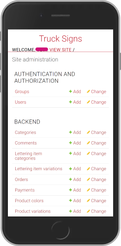
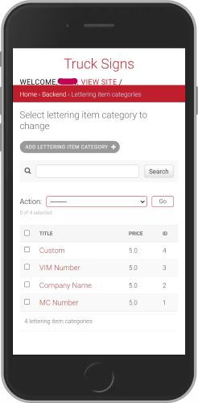
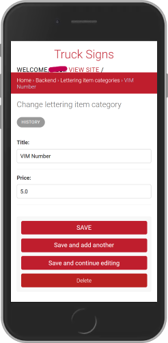
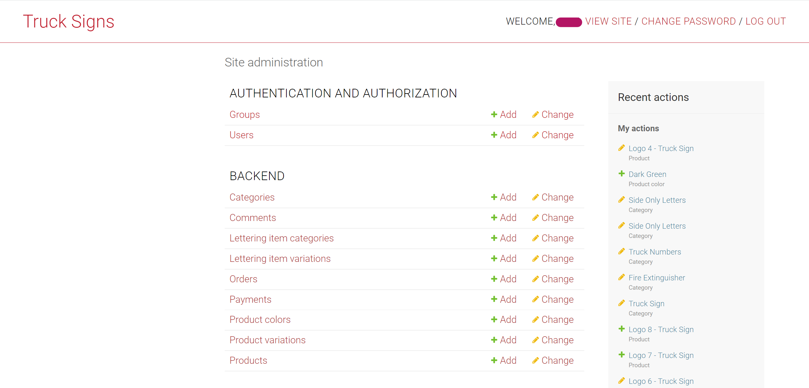
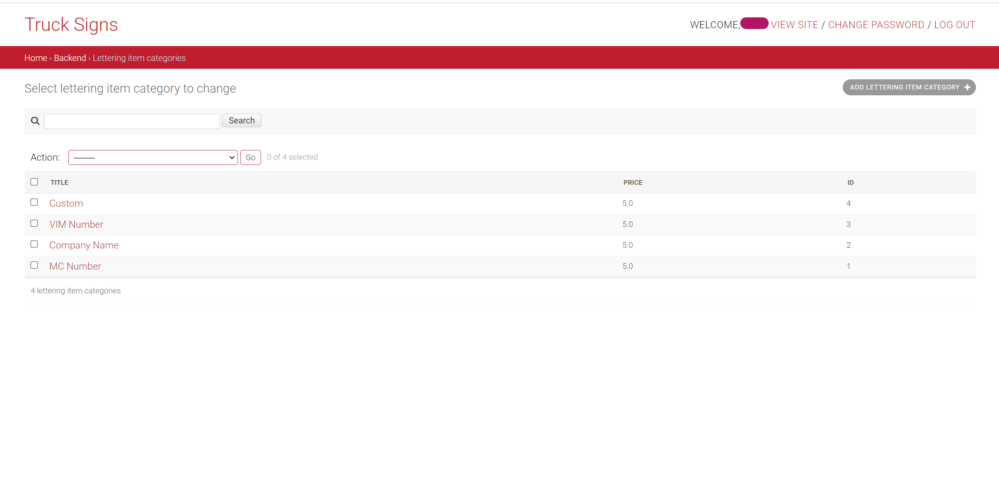
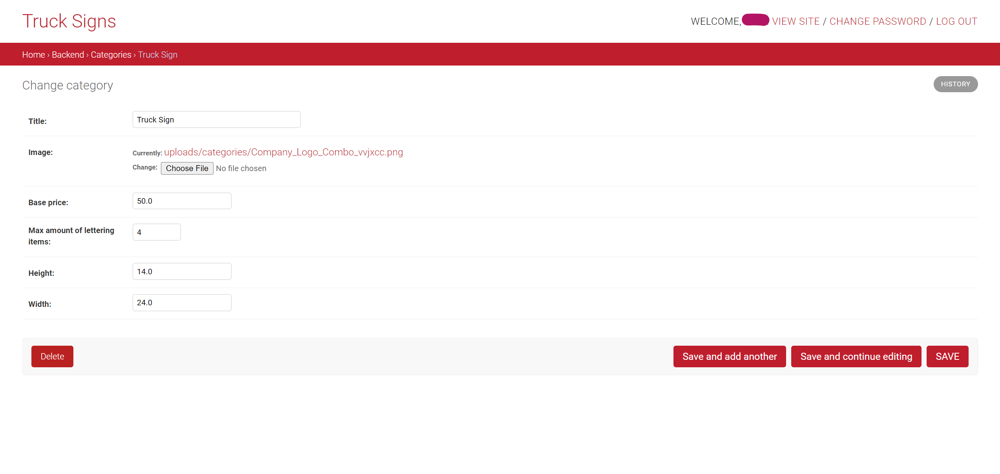

<div align="center">

# Signs for Trucks

    


__Signs for Trucks__ is an online store to buy pre-designed vinyls with custom lines of letters (often called truck letterings).
The store also allows clients to upload their own designs and to customize them on the website as well.

This repository contains the **backend** (Django REST API + admin panel), orchestrated with **Docker Compose** together with a **PostgreSQL** database. The app is served by **Gunicorn** (WSGI) and static files by **WhiteNoise**.

**Submission checklist:** [docs/checklist.pdf](./docs/checklist.pdf)

</div>

## Table of Contents

- [Signs for Trucks](#signs-for-trucks)
  - [Table of Contents](#table-of-contents)
  - [Prerequisites](#prerequisites)
  - [Quickstart](#quickstart)
  - [Usage](#usage)
    - [Environment Variables](#environment-variables)
    - [Database Switch via MODE](#database-switch-via-mode)
    - [Docker Setup](#docker-setup)
    - [Volumes and Persistence](#volumes-and-persistence)
    - [Useful Commands](#useful-commands)
    - [Models](#models)
    - [Brief Explanation of the Views](#brief-explanation-of-the-views)
  - [CI Pipelines](#ci-pipelines)
  - [Local Development without Docker](#local-development-without-docker)
  - [Security Notes](#security-notes)
  - [Troubleshooting](#troubleshooting)
  - [Screenshots of the Django Backend Admin Panel](#screenshots-of-the-django-backend-admin-panel)
  - [Additional Information](#additional-information)

## Prerequisites

* [Docker](https://docs.docker.com/get-docker/) with [Docker Compose v2](https://docs.docker.com/compose/)
* [Git](https://git-scm.com/install/)
* [Python 3.12](https://www.python.org/downloads/release/python-3120/) – only for local development and linting

## Quickstart

1. Clone the repo:
    ```bash
    git clone git@github.com:Developer-Akademie-DevSecOpsKurs/truck-signs-api.git
    cd truck-signs-api
    ```

2. Copy `example.env` to `.env` and replace the placeholders with your own values (see [Environment Variables](#environment-variables)):
    ```bash
    cp example.env .env
    ```
    Generate a secure `SECRET_KEY` and passwords:
    ```bash
    python -c "import secrets; print(secrets.token_urlsafe(50))"
    ```

3. Build and start the stack:
    ```bash
    docker compose up -d --build
    ```
    On the first start, `entrypoint.sh` automatically runs the migrations, collects the static files and creates the superuser from the `DJANGO_SUPERUSER_*` variables.

4. Open the admin panel and log in with the superuser credentials from `.env`:
    - locally: `http://localhost:8020/admin/`
    - on a VM: `http://<your-vm-ip>:8020/admin/`

> [!WARNING]
> Avoid the `$` character in `.env` values – Docker Compose interprets it as a variable. Use `$$` or wrap the value in single quotes.

> [!NOTE]
> The root URL `/` returns *Not Found*. This is expected, because the project is an API.

## Usage

### Environment Variables

All configuration is provided via the `.env` file in the project root. Never commit this file – only the variable **names** are documented here, never their values.

| Variable                    | Required | Default in Compose  | Description                                                    |
| --------------------------- | :------: | ------------------- | -------------------------------------------------------------- |
| `SECRET_KEY`                | ✅       |                     | Django secret key                                              |
| `DB_PASSWORD`               | ✅       |                     | PostgreSQL password                                            |
| `ALLOWED_HOSTS`             | ✅       |                     | Comma-separated hosts, e.g. `localhost,127.0.0.1,<your-vm-ip>` |
| `CSRF_TRUSTED_ORIGINS`      | ✅       |                     | Comma-separated origins, e.g. `http://<your-vm-ip>:8020`       |
| `DJANGO_SUPERUSER_USERNAME` | ✅       |                     | Superuser created automatically on startup                     |
| `DJANGO_SUPERUSER_EMAIL`    | ✅       |                     | Email of the superuser                                         |
| `DJANGO_SUPERUSER_PASSWORD` | ✅       |                     | Password of the superuser                                      |
| `DB_NAME`                   |          | `trucksigns_db`     | PostgreSQL database name                                       |
| `DB_USER`                   |          | `trucksigns_user`   | PostgreSQL user                                                |
| `DB_HOST`                   |          | `db`                | Database host (Compose service name)                           |
| `DB_PORT`                   |          | `5432`              | Database port                                                  |
| `MODE`                      |          | `prod`              | `prod` = PostgreSQL, `dev` = SQLite                            |
| `DEBUG_ENABLED`             |          | `False`             | Django debug mode                                              |
| `APP_PORT`                  |          | `8020`              | Host port of the app                                           |
| `CORS_ALLOWED_ORIGINS`      |          |                     | Allowed frontend origins                                       |
| `LOG_LEVEL`                 |          |                     | Log level in production (`ERROR` if unset)                     |
| `CLOUD_NAME`                |          |                     | Cloudinary cloud name – enables Cloudinary as media storage    |
| `CLOUD_API_KEY`             |          |                     | Cloudinary API key                                             |
| `CLOUD_API_SECRET`          |          |                     | Cloudinary API secret                                          |
| `EMAIL_HOST_USER`           |          |                     | SMTP user for order emails (currently disabled)                |
| `EMAIL_HOST_PASSWORD`       |          |                     | SMTP password                                                  |
| `EMAIL_ADMIN`               |          |                     | Admin email for notifications                                  |

`docker-compose.yml` contains no hard-coded configuration values: every value is read from `.env` with the syntax `${VARIABLE:-default}`, and the default is only used if the variable is not set. Secrets (`DB_PASSWORD`) have no default – Compose stops with an error if it is missing.

### Database Switch via MODE

- `MODE=prod` -> PostgreSQL, using `DB_NAME`, `DB_USER`, `DB_PASSWORD`, `DB_HOST`, `DB_PORT`.
- `MODE` unset or `MODE=dev` -> SQLite at `src/db.sqlite3`; no DB env vars needed.

### Docker Setup

```
docker compose up -d --build
   │
   ├─ db (postgres:16-alpine) ── healthcheck: pg_isready ── "healthy"
   │
   └─ backend (built from Dockerfile, starts when db is healthy)
        └─ entrypoint.sh
             ├─ waits for the database
             ├─ collectstatic
             ├─ migrate
             ├─ creates the superuser (skipped if it already exists)
             └─ gunicorn (WSGI) on port 8020
```

- **Dockerfile:** official `python:3.12-slim` base image, dependencies installed from `requirements.txt` (cached layer), runs as a non-root user, exposes port `8020`. The complete start flow lives in `entrypoint.sh` (no separate `CMD`).
- **entrypoint.sh:** waits until PostgreSQL is reachable, runs `collectstatic` and the migrations, creates the superuser idempotently with `createsuperuser --noinput` (only if the user does not exist yet), then starts Gunicorn with `exec`, so Gunicorn runs as PID 1 and receives stop signals directly.
- **docker-compose.yml:** defines the `db` and `backend` services. They communicate over the default Compose network, the backend reaches the database via the hostname `db`. PostgreSQL has no published port and is only reachable inside this network.

### Volumes and Persistence

| Volume          | Mounted at                  | Content                           |
| --------------- | --------------------------- | --------------------------------- |
| `postgres_data` | `/var/lib/postgresql/data`  | PostgreSQL data                   |
| `static_data`   | `/app/src/staticfiles`      | Collected static files            |
| `media_data`    | `/app/src/mediafiles`       | Uploaded media (if no Cloudinary) |

Data is kept after `docker compose down && docker compose up -d`.
`docker compose down -v` deletes the volumes, including the database.

### Useful Commands

```bash
docker compose ps                      # show containers and health status
docker compose logs -f backend         # follow backend logs
docker compose exec backend bash       # shell inside the backend container
docker compose down                    # stop the stack (data is kept)
docker compose up -d --build           # rebuild after code changes
```

### Models

Most of the models do what can be inferred from their name. The following notes make the purpose of some models clearer:
- __Category Model:__ The category of the vinyls in the store. It contains the title of the category as well as the basic properties shared among products that belong to the same category. For example, _Truck Logo_ is a category for all vinyls that have a logo of a truck plus some lines of lettering (the vinyls are instances of the model _Product_). Another category is _Fire Extinguisher_, for all vinyls that have a logo of a fire extinguisher.
- __Lettering Item Category:__ The category of the lettering, for example: _Company Name_, _VIN NUMBER_, ... Each has a different pricing.
- __Lettering Item Variations:__ Contains a foreign key to the __Lettering Item Category__ and the text added by the client.
- __Product Variation:__ Has the original product as a foreign key, plus the lettering lines (instances of the __Lettering Item Variations__ model) added by the client.

> [!NOTE]
> To create Truck vinyls with Truck logos in them, first create the __Category__ Truck Sign,
> and then the __Product__ (can have any name). This makes sure the frontend retrieves
> the Truck vinyls for display in the Product Grid, as it only fetches the products of the
> category Truck Sign.

### Brief Explanation of the Views

Most of the views are CBV imported from _rest_framework.generics_. They allow the backend API to do the basic CRUD operations and inherit from _ListAPIView_, _CreateAPIView_, _RetrieveAPIView_, and so on.

The behavior of some views had to be modified for functionalities such as creating an order and a payment. Both are implemented in the same view, so it inherits from _GenericAPIView_. Another example is the _UploadCustomerImage_ view, which takes the vinyl template uploaded by the client and creates a new product based on it.

## CI Pipelines

The repository uses **GitHub Actions** (`.github/workflows/`).

### Lint and Test (`test.yaml`)

Runs on every push and pull request to `main` when Python files or `requirements.txt` change.

| Job    | What it does                                                                                       |
| ------ | -------------------------------------------------------------------------------------------------- |
| `lint` | `flake8 .` (code errors and style), `black --check .` (formatting), `isort --check-only .` (import order) |
| `test` | Runs only if `lint` passes. Executes `python manage.py test` with `MODE=dev` (SQLite, no external services) |

Run the same checks locally before pushing:

```bash
pip install -r requirements.txt
flake8 .
black --check .
isort --check-only .
cd src && MODE=dev python manage.py test --verbosity=2
```

Formatting and linting rules are configured in `pyproject.toml` (line length 120, Python 3.12).

### Check Open PR (`check-open-pr.yaml`)

Runs on every push to a branch other than `main` and when a pull request is opened. It fails if the branch has **no open pull request**, so every feature branch must be submitted through a PR.

> [!TIP]
> The first push of a new branch fails until the pull request is opened. Open the PR right after the first push – the check then runs again and passes.

## Local Development without Docker

```bash
python -m venv venv
source venv/bin/activate        # Linux / macOS
venv\Scripts\activate           # Windows
pip install -r requirements.txt
python src/manage.py migrate
python src/manage.py collectstatic
python src/manage.py runserver
```

The development server runs at `http://localhost:8000`. Without `MODE=prod`, SQLite is used.

## Security Notes

- Never commit SSH keys, passwords, tokens or IP addresses. Use the `.env` file – it is excluded via `.gitignore` and `.dockerignore`.
- The README and `example.env` only contain variable names and placeholders, never real values.
- The container runs as a non-root user.
- `DEBUG` is disabled in production mode.
- PostgreSQL is only reachable inside the Compose network.

## Troubleshooting

**`The "xyz" variable is not set. Defaulting to a blank string.`**
A value in `.env` contains `$`. Escape it as `$$` or wrap the value in single quotes.

**`password authentication failed for user ...`**
PostgreSQL sets the password only on the first start. After changing `DB_PASSWORD`, recreate the volume (deletes the data): `docker compose down -v && docker compose up -d --build`

**`exec /app/entrypoint.sh: no such file or directory`**
`entrypoint.sh` has Windows line endings (CRLF). Convert it to LF and rebuild.

**`400 Bad Request`**
The host is missing in `ALLOWED_HOSTS` in `.env`.

**`403 CSRF verification failed` on admin login**
The origin (e.g. `http://<your-vm-ip>:8020`) is missing in `CSRF_TRUSTED_ORIGINS` in `.env`.

**`500 Server Error`**
Check the logs: `docker compose logs backend`.

---

## Screenshots of the Django Backend Admin Panel

### Mobile View

<div style="padding: 0 5rem; width: 100%;  display: flex; gap: 5rem; justify-content: center; flex-wrap: wrap;">







</div>

### Desktop View

<div style="padding: 0 5rem; width: 100%; display: flex; flex-direction: column; gap: 2rem; align-items: center; justify-content: center;">







</div>

## Additional Information

### Postgresql Database

- Setup Database: [Digital Ocean Link for Django Deployment on VPS](https://www.digitalocean.com/community/tutorials/how-to-set-up-django-with-postgres-nginx-and-gunicorn-on-ubuntu-16-04)

### Docker

- [Docker Official Documentation](https://docs.docker.com/)
- Dockerizing Django, PostgreSQL, Gunicorn, and Nginx:
    - Github repo of sunilale0: [Link](https://github.com/sunilale0/django-postgresql-gunicorn-nginx-dockerized/blob/master/README.md#nginx)
    - Michael Herman article on testdriven.io: [Link](https://testdriven.io/blog/dockerizing-django-with-postgres-gunicorn-and-nginx/)

### Django and DRF

- [Django Official Documentation](https://docs.djangoproject.com/en/5.2/)
- Modify the Django Admin:
    - Small modifications (add searching, columns, ...): [Link](https://realpython.com/customize-django-admin-python/)
    - Modify Templates and css: [Link from Medium](https://medium.com/@brianmayrose/django-step-9-180d04a4152c)
- [Django Rest Framework Official Documentation](https://www.django-rest-framework.org/)
- More about Nested Serializers: [Stackoverflow Link](https://stackoverflow.com/questions/51182823/django-rest-framework-nested-serializers)
- More about GenericViews: [Testdriven.io Link](https://testdriven.io/blog/drf-views-part-2/)

### Miscellaneous

- Create Virtual Environment with Virtualenv and Virtualenvwrapper: [Link](https://docs.python-guide.org/dev/virtualenvs/)
- [Configure CORS](https://www.stackhawk.com/blog/django-cors-guide/)
- [Setup Django with Cloudinary](https://cloudinary.com/documentation/django_integration)