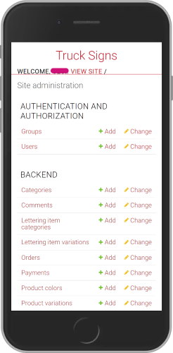
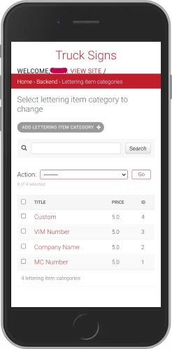
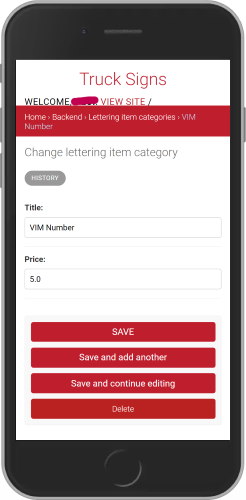
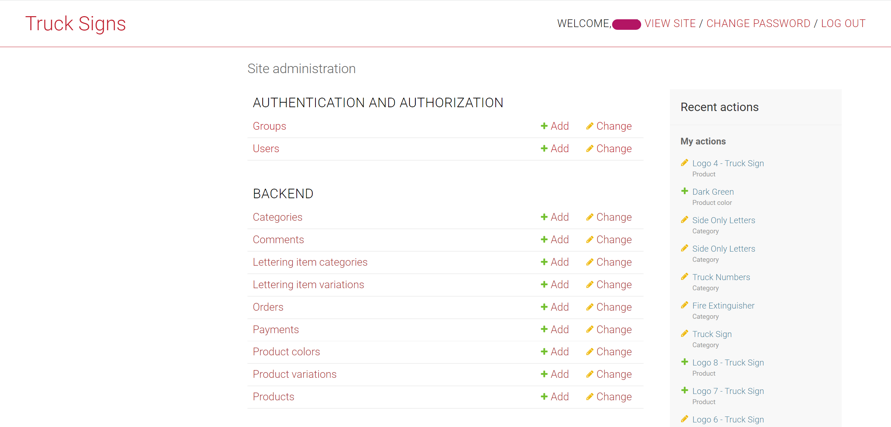
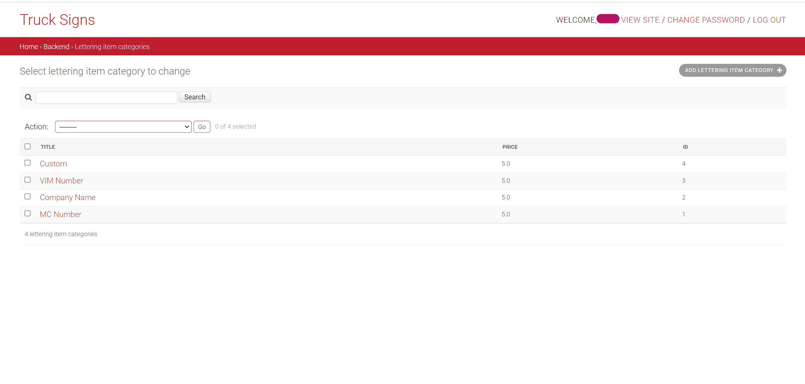
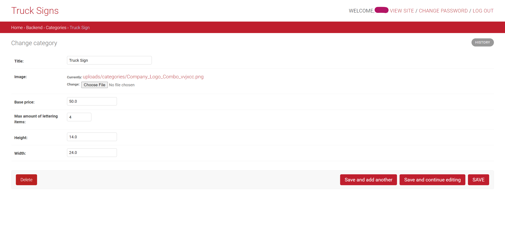

<div align="center">

# Signs for Trucks

  


__Signs for Trucks__ is an online store to buy pre-designed vinyls with custom lines of letters (often call truck letterings).
The store also allows clients to upload their own designs and to customize them on the website as well.

</div>

This repository holds the backend of the Truck Signs store: a Django application with a Django REST Framework API, served by gunicorn and backed by PostgreSQL, packaged to run as a Docker Compose stack (`Dockerfile`, `docker-compose.yml`, `entrypoint.sh`). The API is published on port `8020`. All files of the setup are listed under [Repository Files](#repository-files).

## Table of Contents

- [Signs for Trucks](#signs-for-trucks)
  - [Table of Contents](#table-of-contents)
  - [Prerequisites](#prerequisites)
  - [Quickstart](#quickstart)
    - [How to Build the Image](#how-to-build-the-image)
  - [Usage](#usage)
    - [Settings](#settings)
    - [Control Application Settings via Env-Variables](#control-application-settings-via-env-variables)
    - [Docker Compose](#docker-compose)
    - [Docker Run](#docker-run)
    - [Models](#models)
    - [Brief Explanation of the Views](#brief-explanation-of-the-views)
    - [Local Installation without Docker](#local-installation-without-docker)
  - [CI Pipelines](#ci-pipelines)
  - [Repository Files](#repository-files)
  - [Screenshots of the Django Backend Admin Panel](#screenshots-of-the-django-backend-admin-panel)
    - [Mobile View](#mobile-view)
    - [Desktop View](#desktop-view)
  - [Additional Information](#additional-information)
    - [Postgresql Database](#postgresql-database)
    - [Docker](#docker)
    - [Django and DRF](#django-and-drf)
    - [Miscellaneous](#miscellaneous)

## Prerequisites

* [Docker](https://docs.docker.com/get-docker/) including Docker Compose
* [Git](https://git-scm.com/install/)

Only for the [local installation without Docker](#local-installation-without-docker):

* [Python 3.12.0](https://www.python.org/downloads/release/python-3120/)

## Quickstart

1. Clone the repo:
```bash
git clone https://github.com/bjoerndaigger/truck-signs-api
cd truck-signs-api
```

2. Copy the content of the example.env file into a .env file:
```bash
cp example.env .env
```

3. Open the `.env` file, remove the `#` in front of the following variables and set your own values:
```bash
SECRET_KEY=<YOUR_SECRET_KEY>
ALLOWED_HOSTS=<COMMA_SEPARATED_HOSTS>
DB_NAME=<YOUR_DB_NAME>
DB_USER=<YOUR_DB_USER>
DB_PASSWORD=<YOUR_DB_PASSWORD>
DJANGO_SUPERUSER_PASSWORD=<YOUR_ADMIN_PASSWORD>
```

4. Build the image and start the containers:
```bash
docker compose up --build -d
```

5. Open the admin panel at [http://localhost:8020/admin/](http://localhost:8020/admin/) and log in with the superuser (default username: `admin`, password: the value of `DJANGO_SUPERUSER_PASSWORD`).

6. Stop the containers (the data is kept):
```bash
docker compose down
```

> [!WARNING]
> Never use `docker compose down -v`. The `-v` flag deletes the volume with the database data.

### How to Build the Image

Build the image from the `Dockerfile` in the project root:

```bash
docker build -t trucksigns-api .
```

Or build it through Docker Compose:

```bash
docker compose build
```

## Usage

### Settings

The `settings.py` folder inside the `src/tsa_app` folder contains the different settings configuration for the application.

The `example.env` file in the project root contains an overview about configuration values that can be set for the app.

### Control Application Settings via Env-Variables

You can provide all configuration via a `.env` file in the project root.
Copy `example.env` to `.env`, fill in the required values (DB, SECRET_KEY, etc.), and keep this file out of version 
control to avoid leaking secrets.

**Database switch via MODE**
- `MODE=prod` -> PostgreSQL, using `DB_NAME`, `DB_USER`, `DB_PASSWORD`, `DB_HOST`, `DB_PORT` from `.env`.
- `MODE` unset or `MODE=dev` -> SQLite at `src/db.sqlite3`; no DB env vars needed.

**Variables for the Docker setup**

| Variable | Required | Description |
|---|---|---|
| `SECRET_KEY` | yes | Django secret key |
| `ALLOWED_HOSTS` | yes | Comma-separated list of hosts that may reach the API, e.g. `localhost,127.0.0.1,<YOUR_SERVER_IP>` |
| `DB_NAME` | yes | Name of the PostgreSQL database |
| `DB_USER` | yes | PostgreSQL user |
| `DB_PASSWORD` | yes | Password of the PostgreSQL user |
| `DJANGO_SUPERUSER_PASSWORD` | yes | Password of the superuser that is created on the first start |
| `DJANGO_SUPERUSER_USERNAME` | no | Superuser name, default: `admin` |
| `DJANGO_SUPERUSER_EMAIL` | no | Superuser e-mail, default: `admin@example.com` |

`docker-compose.yml` sets `MODE=prod`, `DEBUG_ENABLED=False`, `DB_HOST=db` and `DB_PORT=5432` for the `backend` service itself. Values in the `.env` file for these variables have no effect in Docker Compose.

> [!NOTE]
> The `.env` file is read by Docker Compose. Do not commit it. Only `example.env` belongs in the repository.

### Docker Compose

`docker-compose.yml` defines two services:

| Service | Image | Purpose |
|---|---|---|
| `db` | `postgres:18.7-alpine` | PostgreSQL database, not reachable from outside the Docker network |
| `backend` | `trucksigns-api` (built from `Dockerfile`) | Django application, published on port `8020` |

Both services use the restart policy `unless-stopped` and share the network `tsa-network`. The `backend` service reaches the database through the service name `db`.

The database data is stored in the named volume `postgres_data`. It survives `docker compose down` and a restart of the containers.

Commands (sensitive values are read from the `.env` file, they are not part of the command):

```bash
# build the image and start both services in the background
docker compose up --build -d

# start without rebuilding
docker compose up -d

# show the logs of the application
docker compose logs -f backend

# stop and remove the containers (the volume with the data is kept)
docker compose down
```

On every start of the `backend` container, `entrypoint.sh` does the following:

1. waits until the database accepts connections (`db:5432`)
2. runs `python manage.py migrate`
3. runs `python manage.py collectstatic --noinput`
4. creates the superuser, unless a user with this name already exists
5. starts the application with gunicorn on `0.0.0.0:8020`

**How to change the setup**

- __Other host port:__ change the left part of the port mapping of the `backend` service, e.g. `'8080:8020'`.
- __Other superuser:__ set `DJANGO_SUPERUSER_USERNAME`, `DJANGO_SUPERUSER_EMAIL` and `DJANGO_SUPERUSER_PASSWORD` in the `.env` file. An existing user is not changed.
- __Other database credentials:__ change `DB_NAME`, `DB_USER` and `DB_PASSWORD` in the `.env` file. PostgreSQL only uses these values when the volume is created. For an existing volume the old credentials stay active.
- __Start from an empty database:__ `docker compose down -v` deletes the volume and all data.

### Docker Run

The containers can also be started without Docker Compose. Replace the placeholders with your own values.

```bash
# network for both containers
docker network create tsa-network

# database
docker run -d --name db --network tsa-network \
  -e POSTGRES_DB=<DB_NAME> \
  -e POSTGRES_USER=<DB_USER> \
  -e POSTGRES_PASSWORD=<DB_PASSWORD> \
  -v postgres_data:/var/lib/postgresql \
  postgres:18.7-alpine

# application (image built with: docker build -t trucksigns-api .)
docker run -d --name tsa_backend --network tsa-network -p 8020:8020 \
  -e MODE=prod \
  -e DB_HOST=db \
  -e DB_PORT=5432 \
  -e DB_NAME=<DB_NAME> \
  -e DB_USER=<DB_USER> \
  -e DB_PASSWORD=<DB_PASSWORD> \
  -e SECRET_KEY=<YOUR_SECRET_KEY> \
  -e ALLOWED_HOSTS=<COMMA_SEPARATED_HOSTS> \
  -e DJANGO_SUPERUSER_PASSWORD=<YOUR_ADMIN_PASSWORD> \
  trucksigns-api
```

> [!NOTE]
> The database container must be named `db`, because `entrypoint.sh` waits for the host `db`.
> Without `-e MODE=prod` the application uses SQLite instead of PostgreSQL.

### Models

Most of the models do what can be inferred from their name. The following dots are notes about some of the models to make clearer their propose:
- __Category Model:__ The category of the vinyls in the store. It contains the title of the category as well as the basic properties shared among products that belong to a same category. For example, _Truck Logo_ is a category for all vinyls that has a logo of a truck plus some lines of letterings (note that the vinyls are instances of the model _Product_). Another category is _Fire Extinguisher_, that is for all vinyls that has a logo of a fire extinguisher.
- __Lettering Item Category:__ This is the category of the lettering, for example: _Company Name_, _VIM NUMBER_, ... Each has a different pricing.
- __Lettering Item Variations:__ This contains a foreign key to the __Lettering Item Category__ and the text added by the client.
- __Product Variation:__ This model has the original product as a foreign key, plus the lettering lines (instances of the __Lettering Item Variations__ model) added by the client.

### Brief Explanation of the Views

Most of the views are CBV imported from _rest_framework.generics_, and they allow the backend api to do the basic CRUD operations expected, and so they inherit from the _ListAPIView_, _CreateAPIView_, _RetrieveAPIView_, ..., and so on.

The behavior of some of the views had to be modified to address functionalities such as creation of order and payment, as in this case, for example, both functionalities are implemented in the same view, and so a _GenericAPIView_ was the view from which it inherits. Another example of this is the _UploadCustomerImage_ View that takes the vinyl template uploaded by the clients and creates a new product based on it.

### Local Installation without Docker

1. Clone the repo:
    ```bash
    git clone <INSERT URL>
    cd truck-signs-api
    ```
1. Configure a virtual env
    ```bash
    python -m venv venv
    venv\Scripts\activate
    ```
1. Configure the environment variables.
    1. Copy the content of the `example.env` file that is on projects root level into a `.env` file:
        ```bash
        cp example.env .env
        ```
    2. The new `.env` file should contain all the environment variables necessary to run all the django app in all the environments. However, the only needed variables for the development environment to run are the following:
        ```bash
        SECRET_KEY
        DB_NAME
        DB_USER
        DB_PASSWORD
        DB_HOST
        DB_PORT
        EMAIL_HOST_USER
        EMAIL_HOST_PASSWORD
        ```
    3. For the `postgres` database, the default configuration should be:
        ```bash
        DB_NAME=trucksigns_db
        DB_USER=trucksigns_user
        DB_PASSWORD=<YOUR_DB_PASSWORD>
        DB_HOST=localhost
        DB_PORT=5432
        ```
    4. The SECRET_KEY is the django secret key. To generate a new one see: [Stackoverflow Link](https://stackoverflow.com/questions/41298963/is-there-a-function-for-generating-settings-secret-key-in-django)

    5. The `EMAIL_HOST_USER` and the `EMAIL_HOST_PASSWORD` are the credentials to send emails from the website when a client makes a purchase. This is currently disable, but the code to activate this can be found in views.py in the create order view as comments. Therefore, any valid email and password will work.
1. Run the migrations:
    ```bash
    python src/manage.py makemigrations
    python src/manage.py migrate
    ```
1. Collect static files:
    ```bash
    python src/manage.py collectstatic
    ```
1. Run the app:
    ```bash
    python src/manage.py runserver
    ```
1. (Optional step) To create a super user run:
    ```bash
    python src/manage.py createsuperuser
    ```
1. (Optional step) Set up the database. [Django database setup example](https://www.digitalocean.com/community/tutorials/how-to-set-up-django-with-postgres-nginx-and-gunicorn-on-ubuntu-16-04).

Congratulations =) !!! The App should be running in [localhost:8000](http://localhost:8000)

> [!NOTE]
> To create Truck vinyls with Truck logos in them, first create the __Category__ Truck Sign,
> and then the __Product__ (can have any name). This is to make sure the frontend retrieves
> the Truck vinyls for display in the Product Grid as it only fetches the products of the
> category Truck Sign.

---

## CI Pipelines

The repository contains three GitHub Actions workflows in `.github/workflows/`:

| Workflow | File | Trigger | Purpose |
|---|---|---|---|
| Lint and Test Python Code Base | `test.yaml` | Push or pull request to `main`, only if `*.py` files or `requirements.txt` change | Runs linting and the Django tests |
| Check open PR for feature branch | `check-open-pr.yaml` | Push to any branch except `main`, and when a pull request is opened | Fails if the branch has no open pull request |
| Build Application | `build.yaml` | Push of a tag, or manual start (`workflow_dispatch`) | Builds the Docker image and pushes it to the GitHub Container Registry (`ghcr.io`) |

**Lint and Test (`test.yaml`)**

1. `lint`: installs the dependencies with Python 3.12 and runs `flake8`, `black --check` and `isort --check-only`.
2. `test`: runs only if `lint` succeeds. It sets `MODE=dev` (SQLite) and runs `python manage.py test` in the `src` folder.

**Check open PR (`check-open-pr.yaml`)**

Uses the GitHub CLI to look for an open pull request for the current branch. If none exists, the job fails and asks you to create one.

**Build Application (`build.yaml`)**

Logs in to `ghcr.io` with the built-in `GITHUB_TOKEN`, builds the image with Docker Buildx and pushes it with two tags: `latest` and the name of the pushed tag.

## Repository Files

| File | Description |
|---|---|
| `Dockerfile` | Builds the application image (Python 3.12 slim, installs dependencies, starts `entrypoint.sh`) |
| `docker-compose.yml` | Runs the `backend` and `db` services with a named volume for the database |
| `.dockerignore` | Keeps `.env`, the git history and local artefacts out of the Docker build context |
| `.gitignore` | Keeps `.env`, virtual environments and generated files out of version control |
| `entrypoint.sh` | Start script of the container (database wait, migrations, static files, superuser, gunicorn) |
| `example.env` | Template for the `.env` file with all configurable variables |
| `requirements.txt` | Python dependencies |
| `pyproject.toml` | Configuration for `black`, `isort` and `flake8` (used by the lint job in CI) |
| `Procfile` | Start command (`gunicorn`) for platforms that read a Procfile. Not used by the Docker setup, which starts gunicorn in `entrypoint.sh` |
| `docs/testing.md` | Documentation of linting and test tooling |
| `.github/workflows/` | CI workflows, see [CI Pipelines](#ci-pipelines) |
| `src/` | Django application |

## Screenshots of the Django Backend Admin Panel

### Mobile View

<div style="padding: 0 5rem; width: 100%;  display: flex; gap: 5rem; justify-content: center; flex-wrap: wrap;">







</div>

### Desktop View


<div style="padding: 0 5rem; width: 100%; display: flex; flex-direction: column; gap: 2rem; align-items: center; justify-content: center;">







</div>

## Additional Information

### Postgresql Database

- Setup Database: [Digital Ocean Link for Django Deployment on VPS](https://www.digitalocean.com/community/tutorials/how-to-set-up-django-with-postgres-nginx-and-gunicorn-on-ubuntu-16-04)

### Docker

- [Docker Oficial Documentation](https://docs.docker.com/)
- Dockerizing Django, PostgreSQL, guinicorn, and Nginx:
    - Github repo of sunilale0: [Link](https://github.com/sunilale0/django-postgresql-gunicorn-nginx-dockerized/blob/master/README.md#nginx)
    - Michael Herman article on testdriven.io: [Link](https://testdriven.io/blog/dockerizing-django-with-postgres-gunicorn-and-nginx/)

### Django and DRF

- [Django Official Documentation](https://docs.djangoproject.com/en/5.2/)
- Generate a new secret key: [Stackoverflow Link](https://stackoverflow.com/questions/41298963/is-there-a-function-for-generating-settings-secret-key-in-django)
- Modify the Django Admin:
    - Small modifications (add searching, columns, ...): [Link](https://realpython.com/customize-django-admin-python/)
    - Modify Templates and css: [Link from Medium](https://medium.com/@brianmayrose/django-step-9-180d04a4152c)
- [Django Rest Framework Official Documentation](https://www.django-rest-framework.org/)
- More about Nested Serializers: [Stackoverflow Link](https://stackoverflow.com/questions/51182823/django-rest-framework-nested-serializers)
- More about GenericViews: [Testdriver.io Link](https://testdriven.io/blog/drf-views-part-2/)

### Miscellaneous

- Create Virual Environment with Virtualenv and Virtualenvwrapper: [Link](https://docs.python-guide.org/dev/virtualenvs/)
- [Configure CORS](https://www.stackhawk.com/blog/django-cors-guide/)
- [Setup Django with Cloudinary](https://cloudinary.com/documentation/django_integration)